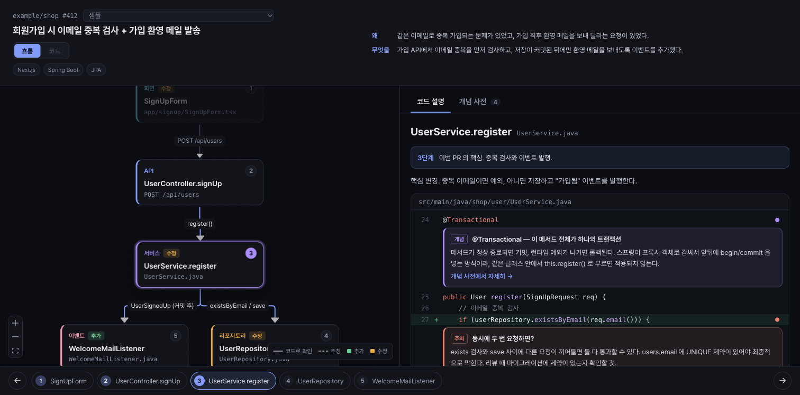

# prflow

> PR 을 diff 순서가 아니라 **실행 흐름 순서**로 읽는 로컬 리뷰 도구.
> 처음 보는 코드도 "어떻게 돌아가는지" 공부하면서 리뷰할 수 있게 돕습니다.



## 왜 만들었나

AI 가 코드를 대신 써 주는 시대가 됐습니다. 바이브 코딩으로 처음 보는 언어·프레임워크의 코드도 금방 만들어지고, 금방 리뷰 요청이 옵니다.

그런데 코드가 생기는 속도를 **그 코드가 어떻게 돌아가는지 이해하는 속도**는 따라가지 못합니다. diff 몇 줄만 보고 LGTM 을 누르다 보면, 코드는 늘어나는데 나는 그대로입니다.

prflow 는 그 반대를 기대하며 만들었습니다.

- PR 하나를 리뷰하는 시간이 **새로운 언어와 프레임워크를 탐구하는 시간**이 되도록
- 모르는 문법·애노테이션을 만나면 그 자리에서 "이건 어떻게 동작해?" 하고 묻고
- 의심스러운 줄에는 "여기 이런 문제 생기지 않아?" 하고 AI 와 함께 따져 보면서

AI 가 대신 이해해 주는 도구가 아니라, **AI 와 함께 코드를 읽으며 내가 자라는 도구**이고 싶습니다.

## 할 수 있는 것

GitHub PR 화면은 바뀐 줄만, 파일 알파벳 순으로 보여줍니다. prflow 는 PR 링크를 받아 AI(Claude Code)가 코드를 직접 읽고 다음을 만들어 줍니다.

- **흐름 그래프** — 화면 → API → 서비스 → 저장소 → DB/외부 순으로, 바뀐 지점 표시. 실선은 코드로 확인한 연결, 점선은 추정
- **읽는 순서** — 어디서부터 읽으면 되는지 단계별로 (← → 키)
- **코드 줄 설명** — 처음 보는 사람이 막힐 지점에 붙는 주석
  - `흐름` 이 줄이 전체 흐름에서 하는 역할
  - `개념` 프레임워크·문법이 실제로 어떻게 동작하는지 (예: `@Transactional` 프록시)
  - `주의` 리뷰 때 확인할 점 (동시성, 트랜잭션 범위, 예외…)
- **개념 사전** — PR 에 나온 개념만 모아서, 어디서 쓰였는지와 함께
- **코드 탐색** — 폴더 트리 + 전체 파일, `⌘+클릭` / `⌘B` 로 정의 이동, `⌘[` 뒤로
- **AI 에게 묻기** — 줄 번호 클릭(Shift+클릭으로 범위) → "여기 동시에 두 요청 오면 문제 없어?" 같은 질문에 AI 가 레포를 읽고 그 줄 아래에 답변

## 시작하기

prflow 는 API 키나 토큰을 따로 저장하지 않습니다. **내 PC 에 이미 로그인된 `gh` 와 `claude` 를 그대로 빌려 씁니다.**

**1. 필요한 도구 설치 + 로그인 (처음 한 번)**

| 도구 | 설치 | 로그인 |
|---|---|---|
| Node.js 20+ | https://nodejs.org | – |
| GitHub CLI | https://cli.github.com | `gh auth login` — 비공개 레포는 접근 권한이 있는 계정으로 |
| Claude Code | https://docs.anthropic.com/en/docs/claude-code | `claude` 를 한 번 실행해 로그인 (Claude 구독 또는 API 키) |

**2. 설치와 점검**

```bash
git clone https://github.com/PoPo015/prflow.git && cd prflow
npm install
npm run doctor        # 도구·로그인 상태 점검
```

**3. 사용**

```bash
npm run analyze https://github.com/<owner>/<repo>/pull/<번호>   # 1~2분
npm run dev                                                     # http://localhost:4173
```

분석 없이 `npm run dev` 만 실행하면 가상의 샘플 PR 을 볼 수 있습니다.
분석과 "AI 에게 묻기" 는 내 Claude 계정의 사용량을 씁니다.

## 어떻게 동작하나

```
PR URL
 ├─ gh 로 PR 정보·diff 조회
 ├─ 레포를 ~/.prflow/repos 에 clone(1회) → PR head 커밋을 ~/.prflow/work/<slug> 에 worktree 로 펼침
 ├─ 빌드 파일로 스택 감지 (Spring, Next.js, Python …)
 ├─ claude -p (Read/Grep/Glob 만 허용) 로 흐름·설명·개념을 JSON 으로 생성
 ├─ 코드 본문은 AI 가 아니라 실제 파일에서 잘라 넣고, 범위 밖 설명·없는 노드를 가리키는 선은 버림
 └─ public/flows/<slug>.json 저장 → 화면이 읽음
```

- 정의 이동은 LSP 없이 `git grep` + 선언 패턴으로 찾는 가벼운 방식입니다. 이름이 같은 메서드가 여러 곳에 있으면 후보 목록이 뜹니다.
- 분석 비용·시간은 PR 크기에 따라 다릅니다. 실행이 끝나면 Claude Code 가 보고한 비용을 출력합니다.

## 보안·데이터

- 서버 없이 내 PC 에서만 돕니다. 코드가 밖으로 나가는 경로는 Claude Code 호출뿐입니다.
- AI 에게는 읽기 도구(Read/Grep/Glob)만 허용합니다. 셸 실행·파일 수정·웹 접근은 막혀 있습니다.
- 분석 결과(`public/flows/`)와 레포 사본(`~/.prflow/`)에는 대상 코드가 들어 있으니 커밋·공유하지 마세요. `public/flows/` 는 `.gitignore` 에 들어 있습니다.
- 회사 코드에 쓸 때는 소속 조직의 AI 사용 정책을 먼저 확인하세요.

## 상태

MVP 입니다. 화면은 다크 테마·데스크톱 기준이고, 테스트는 아직 없습니다.

## License

[MIT](LICENSE)
